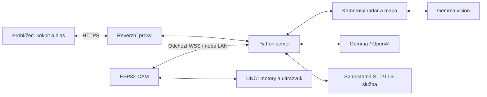

# Kvído — experimentální AI autíčko

Kvído je pokus dát malému autíčku **KUONGSHUN AD176** oči, paměť a schopnost
plnit vícekrokový úkol. Například: „Najdi chromovanou psí misku.“ Cílem je,
aby se rozhlédlo, vybralo cestu, natočilo se, ověřilo směr a pokračovalo
v hledání bez nového příkazu po každém pohybu.

**Stav: experimentální alfa, veřejný vývojový snapshot z 28. 10. 2026.**
Máme vlastní firmware obou desek, webový kokpit, simulátor, serverové řízení,
kamerové mapování a paměť míst. **Večerní živý test 28. 10. skončil nalezením
chromované psí misky a automatickým zastavením.** [Průběh, log a prompty](docs/evidence/2026-10-28-bowl/README.md)
popisují také předchozí pauzu na opravu a zbývající chyby. Jeden úspěch ještě
neprokazuje spolehlivou navigaci po bytě. Test běžel na novější pracovní
verzi; tato aktualizace dokumentace nepřenáší její kód do veřejného snapshotu.

## Co je uvnitř

| Část | Úloha |
| --- | --- |
| Arduino UNO | Motory, náklon kamery, ultrazvuk, časové omezení povelů a zastavení. |
| ESP32-CAM | Kamera, světlo, nastavení Wi-Fi, LAN API a odchozí zabezpečené spojení k serveru. |
| Python / FastAPI | Přihlášení, kokpit, úkoly, kontrola povelů, telemetrie, paměť a komunikace s AI. |
| Kamerový radar | Depth Anything V2 Small + geometrie podlahy, lokální mapa a návrhy dalšího směru. |
| Gemma / OpenAI | Rozpoznání scény a cíle; hlavní kokpit má volbu poskytovatele, radarová alfa používá Gemmu. |
| Telefon / prohlížeč | Obraz, joystick, textové zadání, mikrofon pro STT a přehrávání TTS. |
| Hlas přes Verity | OmniVoice TTS v režimu clone; Whisper large-v3-turbo přes faster-whisper pro STT. |
| Simulátor | Virtuální byt, kamera, kolize, telemetrie a pokusy s navigací bez fyzického auta. |



Auto může přes odchozí relay komunikovat i z jiné Wi-Fi nebo hotspotu.
Vyžaduje vlastní dosažitelný server, internet a správné párování. Samotná AI
neběží na ESP32. Bez backendu zůstávají dostupné jen funkce, které poskytuje
firmware a místní síť.

## Rychlý start: simulátor

Python 3.11 nebo novější. Z kořene tohoto repozitáře v PowerShellu:

```powershell
python -m venv .venv
.\.venv\Scripts\python.exe -m pip install -r requirements-simulator.txt
.\.venv\Scripts\python.exe tools/run_simulator.py --port 28742
```

Otevři **http://127.0.0.1:28742/**. Přihlašovací klíč vznikne při prvním
startu v `data/simulator/access.key`; přečti si ho pouze lokálně.
Simulátor má oddělená data a vynucené odpojení od fyzického auta. Zobrazení
a ruční simulace nevyžadují AI; AI úkoly potřebují dostupný model.

Gemma musí mít obrazový endpoint kompatibilní s `/v1/chat/completions`:

```powershell
$env:ROVER_LLM_URL = 'http://127.0.0.1:8080'
.\.venv\Scripts\python.exe tools/run_simulator.py --port 28742
```

Pro OpenAI vlož vlastní klíč v nastavení kokpitu, načti modely a ověř jejich
obrazové schopnosti. Dostupnost modelů záleží na účtu. Při této volbě se
snímky a zadání posílají OpenAI. Vývojové názvy modelů v kódu nejsou záruka
dostupnosti konkrétního modelu. Radarová alfa má zatím samostatné připojení
ke Gemmě a volba OpenAI v kokpitu ji nepřepíná.

## Dokumentace

- [Aktuální stav, ověření a další práce](docs/STATUS.md)
- [Architektura, rozhodování a paměť](docs/ARCHITEKTURA.md)
- [Instalace, konfigurace, radar, hlas a provoz](docs/PROVOZ.md)
- [Konkrétní TTS/STT a cesta hlasu](docs/HLAS.md)
- [Živý dojezd k misce: záznam a prompty](docs/evidence/2026-10-28-bowl/README.md)
- [Firmware a postup nahrávání](docs/NAHRANI_FIRMWARU.md)
- [Soukromé údaje a bezpečné přispívání](SECURITY.md)
- [Externí součásti a licence](THIRD_PARTY.md)

## Vývoj

```powershell
.\.venv\Scripts\python.exe -m pytest tests -q
```

Testy používají simulované adaptéry a testovací obrázky. Některé kontroly
nad soukromými záznamy se bez těchto záznamů přeskočí. Výsledky testů
nejsou důkazem, že auto dojede k cíli v reálném bytě.

Veřejný repozitář je očištěná kopie pracovních zdrojů, nikoli záloha
nasazeného serveru. Neobsahuje klíče, Wi-Fi hesla, soukromé adresy serverů,
záběry bytu, uloženou paměť ani původní archivy výrobce. Připojení se nastavuje
pro vlastní instalaci; postup je v dokumentaci. Licence pro vlastní kód
projektu zatím nebyla zvolena.
